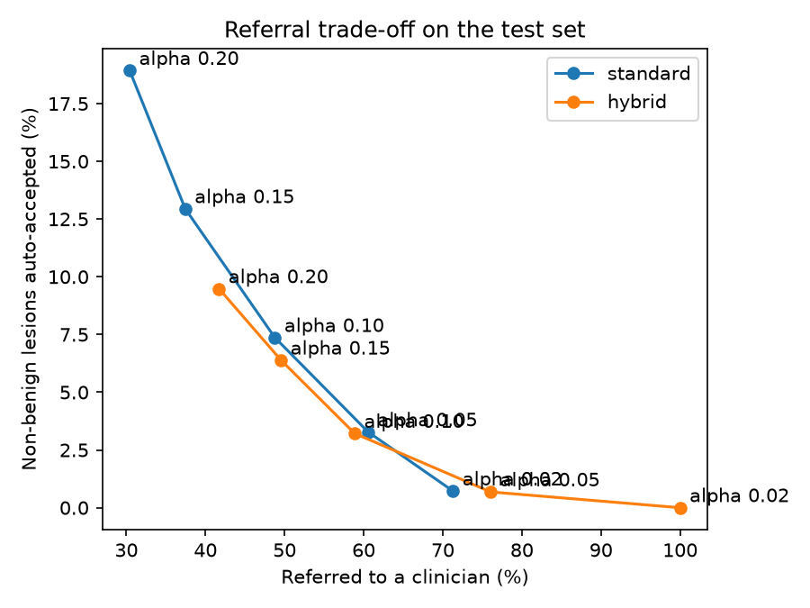
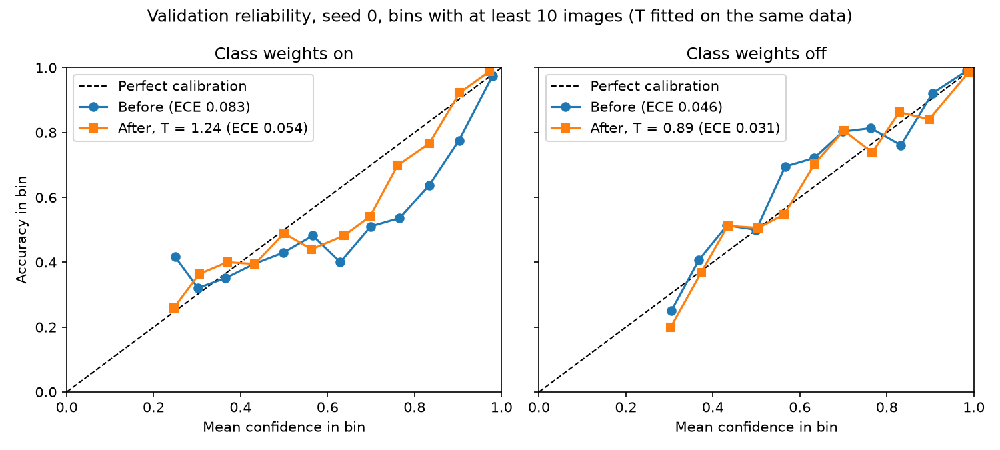
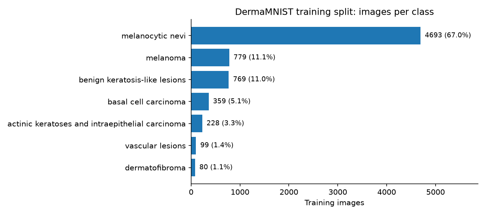
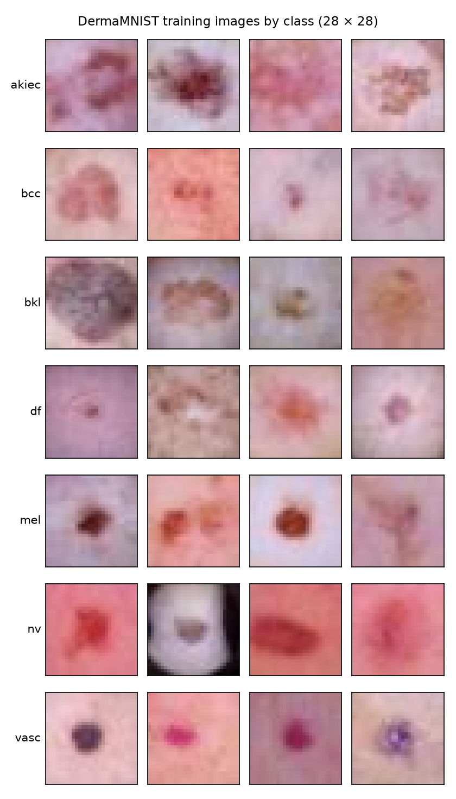

# A skin-lesion classifier that knows when to say "I don't know"


**Result:** on the held-out test set (2,005 images), a fine-tuned ResNet-18 reaches a
balanced accuracy of 0.715 (95% CI 0.676 to 0.754). One temperature parameter, fitted on
validation, cuts the expected calibration error from 0.115 to 0.023. Conformal prediction
sets contain the true diagnosis 92.1% of the time (95% of random splits: 89.4% to 94.2%),
with melanoma at 90%. A referral rule built on the sets sends 59% of lesions to a
clinician and auto-accepts 3.2% of non-benign ones. Under strong blur or low resolution,
the guarantee breaks: melanoma coverage falls to as low as 31%.



## The question

Can a small image classifier give probabilities you can trust, and prediction sets
that contain the true diagnosis 90% of the time, even for rare classes?

## What this shows

- **Pretraining matters most.** An ImageNet-pretrained ResNet-18 at 64 pixels beats a
  small CNN trained from scratch at 28 pixels by 0.15 in balanced accuracy, about ten
  times the spread across seeds.
- **Over-confidence can be fixed with one parameter, but not every miscalibration.**
  Temperature scaling repairs the ResNet's over-confidence (T = 1.87); it cannot repair
  the per-class distortion that class weights cause in the small CNN.
- **A 90% guarantee overall can hide the class that matters.** Standard conformal sets
  cover 90% of all lesions but only 80% of melanomas, because common benign nevi are
  over-covered. Per-class thresholds for the non-benign classes restore 90%.
- **Guarantees end where exchangeability ends.** Under blur or low resolution, the sets
  get smaller while coverage falls: the model becomes confidently wrong.

## Method

**Data splits and protocol.** The official DermaMNIST splits: 7,007 training, 1,003
validation and 2,005 test images. Models are selected and calibrated on validation only.
Every choice (model, temperature, conformal method, alpha, referral rule) was frozen on
12 November 2026, before the test set was first used; the test results were computed
once, with that protocol, and reported as they came out.

**Models.** A small CNN (41,351 parameters) at 28 × 28 pixels, and ResNet-18 with
ImageNet weights at 64 × 64 pixels, fully fine-tuned with Adam (learning rate 3e-4). Both
use class-weighted cross-entropy and early stopping on validation balanced accuracy.

**Calibration.** Temperature scaling: logits divided by one parameter T, fitted on
validation by minimising the negative log-likelihood (NLL). It changes the probabilities,
never the predicted class. Calibration is measured with top-label ECE (15 bins) and NLL.

**Conformal prediction sets.** Score: 1 minus the probability of the true class, on
temperature-scaled probabilities; alpha = 0.10. Three methods:

- *standard:* one threshold for all classes (coverage guaranteed on average);
- *Mondrian:* one threshold per class (coverage guaranteed for each class, but a class
  needs at least 9 calibration images at alpha = 0.10);
- *hybrid* (headline): per-class thresholds for the three non-benign classes, the
  standard threshold for the benign ones. Each non-benign class keeps its own guarantee,
  while rare benign classes do not inflate every set.

Coverage is measured over 1,000 random 50/50 splits of the test set into calibration and
evaluation halves.

**Referral rule.** Accept automatically only when the prediction set holds exactly one
benign class (benign keratosis-like lesion, dermatofibroma, melanocytic nevus, vascular
lesion); refer everything else. This class grouping is a modelling assumption, not
medical advice.

## Results

### 1. Models (validation split)

Baselines: stratified 5-fold cross-validation on the training split (mean ± standard
deviation), then one score on validation. Class weights are balanced in all models.

| Model | CV balanced accuracy | CV macro-F1 | Val balanced accuracy | Val macro-F1 |
| --- | --- | --- | --- | --- |
| Majority class | 0.143 ± 0.000 | 0.115 ± 0.000 | 0.143 | 0.115 |
| Logistic regression (C = 0.1) | 0.414 ± 0.032 | 0.338 ± 0.021 | 0.429 | 0.324 |
| Gradient boosting | 0.343 ± 0.021 | 0.376 ± 0.025 | 0.373 | 0.407 |

Neural networks: three seeds each, mean ± standard deviation.

| Model | Val balanced accuracy |
| --- | --- |
| Small CNN, 28 px, no class weights | 0.413 ± 0.016 |
| Small CNN, 28 px, class weights | 0.542 ± 0.047 |
| **ResNet-18 (ImageNet weights), 64 px, class weights** | **0.696 ± 0.017** |

Each run's score is its best epoch, chosen on validation, so these numbers are slightly
optimistic. The ResNet overfits fast: its validation loss rises after epoch 2 to 4, and
early stopping keeps the best balanced accuracy (epochs 5 to 9). Seed 0 of the ResNet is
the released model; on the test set it scores 0.715, in line with validation.

### 2. Calibration

On validation (seed 0 of each model; T fitted on the same data, so the "after" values
are slightly optimistic):

| Model | Balanced acc. | T | ECE before | ECE after | NLL before | NLL after |
| --- | --- | --- | --- | --- | --- | --- |
| ResNet-18, 64 px | 0.707 | 1.87 | 0.134 | 0.026 | 0.824 | 0.662 |
| Small CNN, class weights | 0.587 | 1.24 | 0.083 | 0.054 | 1.029 | 1.013 |
| Small CNN, no class weights | 0.431 | 0.89 | 0.046 | 0.031 | 0.710 | 0.707 |

On the test set, with T fitted on validation (95% bootstrap intervals):

| Released model | Before scaling | After scaling |
| --- | --- | --- |
| ECE | 0.115 [0.101, 0.133] | 0.023 [0.020, 0.045] |
| NLL | 0.757 [0.691, 0.829] | 0.625 [0.587, 0.665] |



The ResNet is strongly over-confident (T = 1.87), the usual pattern for a large network
fitted to a small dataset, and one temperature fixes almost all of it. The class-weighted
CNN is different: the weights shift each class's probabilities by a different factor, so
a single temperature lowers ECE but barely moves NLL. With about 1,000 images, a perfectly
calibrated model would still show an ECE of about 0.03 (simulated), so ECE values below
about 0.05 are within noise.


### 3. Conformal prediction sets (test set)

Alpha = 0.10; 1,000 random 50/50 calibration and evaluation splits of the test set.

| Method | Coverage (95% of splits) | Melanoma coverage | Mean set size | Referred | Non-benign auto-accepted |
| --- | --- | --- | --- | --- | --- |
| Standard | 0.900 (0.872 to 0.926) | 0.80 | 1.46 | 49% | 7.4% |
| Mondrian | 0.903 (0.874 to 0.927) | 0.90 | 2.05 | 67% | 2.9% |
| **Hybrid** | **0.921 (0.894 to 0.942)** | **0.90** | **1.80** | **59%** | **3.2%** |

Coverage by class:

| Method | akiec | bcc | bkl | df | mel | nv | vasc |
| --- | --- | --- | --- | --- | --- | --- | --- |
| Standard | 0.83 | 0.78 | 0.73 | 0.78 | 0.80 | 0.96 | 0.97 |
| Mondrian | 0.91 | 0.91 | 0.90 | 0.93 | 0.90 | 0.90 | 0.93 |
| Hybrid | 0.91 | 0.91 | 0.73 | 0.78 | 0.90 | 0.96 | 0.97 |

Standard sets meet 90% overall, but only because nevi, two thirds of the data, are
over-covered; melanoma, basal cell carcinoma and actinic keratoses fall to 0.78 to 0.83.
The hybrid brings all three non-benign classes to 0.90 or above, at the cost of slightly
larger sets.

The hybrid was chosen on validation, where full Mondrian was not usable: each validation
half held only about 6 dermatofibroma and 7 vascular images, too few for a finite
threshold, so those classes entered every set and nothing could be auto-accepted. The test
halves hold about twice as many, and there Mondrian works as well (every class at 0.90 or
above). Both are reported; the headline was not switched after seeing test results.

### 4. Referral trade-off (test set)

| Alpha | Method | Coverage | Set size | Referred | Non-benign auto-accepted |
| --- | --- | --- | --- | --- | --- |
| 0.02 | Standard | 0.980 | 2.60 | 71% | 0.7% |
| 0.02 | Hybrid | 0.987 | 3.77 | 100% | 0.0% |
| 0.05 | Standard | 0.951 | 1.90 | 61% | 3.3% |
| 0.05 | Hybrid | 0.961 | 2.58 | 76% | 0.7% |
| 0.10 | Standard | 0.900 | 1.46 | 49% | 7.4% |
| 0.10 | Hybrid | 0.921 | 1.80 | 59% | 3.2% |
| 0.15 | Standard | 0.850 | 1.21 | 37% | 12.9% |
| 0.15 | Hybrid | 0.874 | 1.46 | 50% | 6.4% |
| 0.20 | Standard | 0.801 | 1.07 | 30% | 18.9% |
| 0.20 | Hybrid | 0.827 | 1.25 | 42% | 9.5% |

Choosing alpha is choosing an operating point: fewer missed non-benign lesions cost more
referrals. At every alpha, the hybrid misses about half as many non-benign lesions as
standard sets, for 10 to 15 more points of referrals. Where to operate is a clinical
decision, not a modelling one.

### 5. Shift stress test (test set)

Thresholds calibrated on clean test images (one random half), applied to shifted images
(the other half); alpha = 0.10, 500 splits.

| Shift | Level | Balanced acc. | ECE after T | Coverage, standard | Coverage, hybrid | Melanoma, hybrid | Set size, hybrid |
| --- | --- | --- | --- | --- | --- | --- | --- |
| None | | 0.715 | 0.023 | 0.900 | 0.920 | 0.90 | 1.79 |
| Blur | sigma 0.5 | 0.711 | 0.025 | 0.903 | 0.920 | 0.90 | 1.78 |
| Blur | sigma 1 | 0.550 | 0.051 | 0.867 | 0.898 | 0.83 | 1.77 |
| Blur | sigma 2 | 0.343 | 0.152 | 0.771 | 0.816 | 0.41 | 1.49 |
| Brightness | × 0.5 | 0.205 | 0.085 | 0.775 | 0.823 | 0.67 | 1.75 |
| Brightness | × 0.75 | 0.528 | 0.037 | 0.871 | 0.901 | 0.89 | 1.90 |
| Brightness | × 1.25 | 0.621 | 0.040 | 0.851 | 0.871 | 0.81 | 2.12 |
| Brightness | × 1.5 | 0.491 | 0.077 | 0.721 | 0.754 | 0.81 | 2.78 |
| Resolution | 32 px | 0.479 | 0.081 | 0.838 | 0.882 | 0.70 | 1.70 |
| Resolution | 16 px | 0.333 | 0.154 | 0.757 | 0.803 | 0.31 | 1.46 |

Mild shifts are harmless. Severe ones break the guarantee, and the most dangerous pattern
is under heavy blur and low resolution: the sets get *smaller* while coverage falls,
because the model becomes confidently wrong. The hybrid degrades more slowly than standard
sets under every shift, but neither holds 90%. In use, conformal sets need an input check
(image quality, drift monitoring) or recalibration on data from the new conditions.

## Limitations

- One dataset at 64 × 64 pixels; dermatoscope frame artefacts may act as shortcuts.
- Rare classes are small (23 dermatofibroma and 29 vascular test images), so their
  per-class numbers are noisy.
- The official DermaMNIST splits put images of the same lesion in more than one split
  (Abhishek, Jain and Hamarneh, 2024), so all scores here are likely optimistic. Their
  corrected version, DermaMNIST-C, keeps each lesion in one split; re-running on it is
  the next step.
- The benign grouping behind the referral rule is a modelling assumption.
- **Not for clinical use.** See [MODEL_CARD.md](MODEL_CARD.md).

## How to run

```bash
git clone git@github.com:rababahm/skin-lesion-uncertainty.git
cd skin-lesion-uncertainty
make setup
make reproduce
```

`make reproduce` runs the baselines, trains every model (three seeds each), saves the
frozen model's logits, and regenerates every table and figure above. Seeds are fixed;
runs reproduce exactly on the same machine. It takes about 15 minutes on an Apple M2 and
longer on a CPU (estimate: 1 to 2 hours). Every run is logged to MLflow:
`uv run mlflow ui --backend-store-uri sqlite:///mlflow.db`.

## Repository layout

- `src/skin_lesion_uncertainty/`: `data.py`, `model.py`, `train.py` (training and
  logits), `evaluate.py` (ECE, temperature scaling), `conformal.py`, `decision.py`
  (referral rule), `calibration.py`, `final_evaluation.py`, `shift.py`, `report.py`
- `tests/`: unit tests, run in CI on every push
- `reports/`: figures, and the test and shift results as Markdown

## Data

DermaMNIST, part of [MedMNIST](https://medmnist.com/): dermatoscope images in seven
diagnostic categories, derived from the HAM10000 dataset. Licence CC BY-NC 4.0
(non-commercial). Not for clinical use. The images are downloaded by the `medmnist`
package and never committed.





Please cite:

- Yang et al., "MedMNIST v2: A large-scale lightweight benchmark for 2D and 3D
  biomedical image classification", Scientific Data, 2023.
- Yang, Shi and Ni, "MedMNIST Classification Decathlon: A Lightweight AutoML Benchmark
  for Medical Image Analysis", IEEE International Symposium on Biomedical Imaging (ISBI), 2021.
- Tschandl, Rosendahl and Kittler, "The HAM10000 dataset, a large collection of
  multi-source dermatoscopic images of common pigmented skin lesions", Scientific
  Data, 2018.
- Abhishek, Jain and Hamarneh, "Investigating the Quality of DermaMNIST and Fitzpatrick17k
  Dermatological Image Datasets", arXiv:2401.14497, 2024.

## Licence

Code under MIT. See `LICENSE`.
